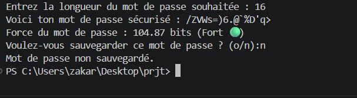

# Cybersecurity Password Generator (Python)

Un générateur de mots de passe sécurisé avec évaluation d'entropie et gestion des erreurs.

## Fonctionnalités
- Génération de mots de passe sécurisés avec le module `secrets`.
- Saisie utilisateur interactive et sécurisée (`try` / `except`).
- Calcul d'entropie mathématique pour mesurer la force du mot de passe.
- Option de sauvegarde locale dans un fichier texte.

## Prérequis
- Python 3.6 ou plus (le module `secrets` est inclus par défaut, aucune installation nécessaire)

## Utilisation
```bash
git clone https://github.com/USERNAME/password-generator.git
cd password-generator
python password_generator.py
```

## Exemple
```
[Entrez la longueur du mot de passe souhaitée : 16
Voici ton mot de passe sécurisé : UDczwj{sRFy2M:Mz
Force du mot de passe : 104.87 bits (Fort 🟢)]
```

## Entropie
L'entropie mesure la difficulté de deviner un mot de passe : `E = L × log2(N)`,
où `L` est la longueur du mot de passe et `N` la taille du jeu de caractères.
Plus l'entropie est élevée, plus le mot de passe est difficile à casser.

## Sécurité
- Le module `secrets` est utilisé à la place de `random`, car il est conçu pour la cryptographie.
- Le fichier `passwords.txt` est ignoré par Git (voir `.gitignore`) et stocke les mots de passe en clair : à utiliser uniquement pour des tests.

## Licence
Ce projet est sous licence MIT. Voir le fichier [LICENSE](LICENSE).
